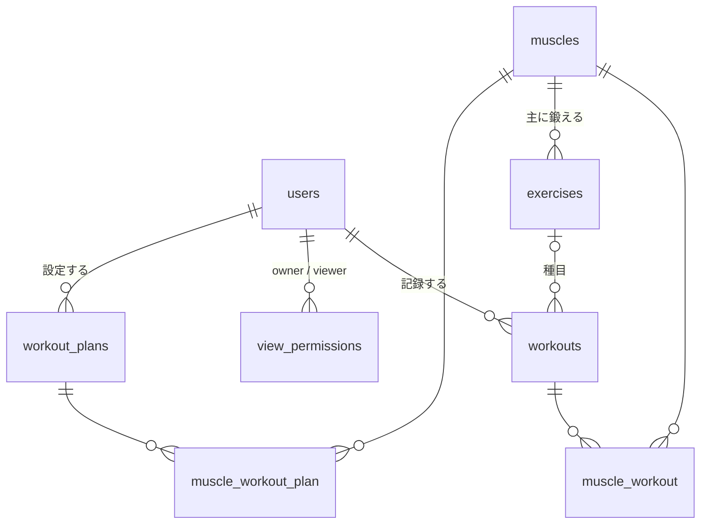

# データベース設計

筋トレ自己管理アプリのデータベース設計。**DB に関する判断はこのファイルが正**。
テーブルやカラムを変えるときは、issue で合意してから、マイグレーションとこのファイルを同じ PR で更新する（ルールは `AGENTS.md`）。

## 方針

- Laravel の Livewire スターターキットを使うため、`users` は既存のものをそのまま使い、カラムは追加しない
- 新規テーブルは **7つ**（記録まわり5つ＋通知プラン2つ）
- 休息中の筋肉を保存するテーブルは作らない。`workouts` から毎回計算する
- 重量・回数・セット数は `workouts` のカラムとして、記録ごとに1つ持つ（#12）
- 日時はすべて `Asia/Tokyo` で保存・計算する。日付の計算は PHP（Carbon）で行い、MySQL 専用の関数は使わない

## テーブル

### muscles（筋肉のマスタ。Seeder で投入）

| カラム | 型 | 備考 |
|---|---|---|
| id | bigint PK | |
| name | string | 大胸筋、広背筋 など |
| | UNIQUE(name) | Seeder の `firstOrCreate` で重複させないため |

### exercises（種目のマスタ。おすすめとフォームの選択肢用。Seeder で投入）

| カラム | 型 | 備考 |
|---|---|---|
| id | bigint PK | |
| name | string | ベンチプレス など |
| muscle_id | foreignId → muscles | 主に鍛える筋肉。cascadeOnDelete |
| default_rest_days | unsignedTinyInteger | 推奨休憩日数。種目を選ぶとフォームの初期値になる |
| | UNIQUE(name) | Seeder の `updateOrCreate` で重複させないため |

### workouts（筋トレ記録）

| カラム | 型 | 備考 |
|---|---|---|
| id | bigint PK | |
| user_id | foreignId → users | cascadeOnDelete |
| exercise_id | foreignId → exercises NULL | nullOnDelete。自己ベスト・推移グラフ・ランキングの集計に使う。種目を選ばず、メニュー名も種目名と一致しない記録は NULL（#16） |
| performed_at | dateTime | 実行日時 |
| menu_name | string | 自由入力のメニュー名（100文字まで） |
| weight | decimal(5,1) NULL | 重量(kg)。自重は NULL。0〜500、0.5 刻み |
| reps | unsignedSmallInteger NULL | 回数。1〜100。フォームでは必須（#12 より前の記録は NULL） |
| sets | unsignedTinyInteger NULL | セット数。1〜20。フォームでは必須（#12 より前の記録は NULL） |
| rest_days | unsignedTinyInteger | 休憩日数（選択式。0〜7） |
| timestamps | | |
| | INDEX(user_id, performed_at) | 休息判定・記録一覧で、ユーザーごとに日時で絞り込むため |

### muscle_workout（記録 ⇔ 使用した筋肉の中間テーブル）

| カラム | 型 | 備考 |
|---|---|---|
| muscle_id | foreignId → muscles | cascadeOnDelete |
| workout_id | foreignId → workouts | cascadeOnDelete |
| | PRIMARY(muscle_id, workout_id) | 同じ記録に同じ筋肉を重複させないため |

### view_permissions（閲覧許可。行がある＝許可済み）

| カラム | 型 | 備考 |
|---|---|---|
| id | bigint PK | |
| owner_id | foreignId → users | 見せる側。cascadeOnDelete |
| viewer_id | foreignId → users | 見る側。cascadeOnDelete |
| | UNIQUE(owner_id, viewer_id) | |

モデルは作らず、`User` の `belongsToMany` で扱う。

- `User::viewers()`：自分が記録を見せている相手（自分が owner の行）
- `User::viewableOwners()`：自分に記録を見せてくれている相手（自分が viewer の行）

### workout_plans（通知プラン。設定した日時・場所・メニュー・筋肉でメールを送る）

| カラム | 型 | 備考 |
|---|---|---|
| id | bigint PK | |
| user_id | foreignId → users | cascadeOnDelete |
| scheduled_at | dateTime | 予定日時。この日時に1回だけ通知する。作成・更新時は現在より後のみ |
| place | string | 場所（自由入力。100文字まで） |
| menu_name | string | メニュー名（100文字まで） |
| is_enabled | boolean | default true。false なら送信しない |
| sent_at | dateTime NULL | 送信日時。NULL なら未送信（二重送信の防止）。予定日時を変えたら NULL に戻す |
| timestamps | | |
| | INDEX(is_enabled, sent_at, scheduled_at) | `reminders:send` が送信対象を毎分探すため |

### muscle_workout_plan（通知プラン ⇔ 筋肉の中間テーブル）

| カラム | 型 | 備考 |
|---|---|---|
| muscle_id | foreignId → muscles | cascadeOnDelete |
| workout_plan_id | foreignId → workout_plans | cascadeOnDelete |
| | PRIMARY(muscle_id, workout_plan_id) | 同じプランに同じ筋肉を重複させないため |

## ER図

## 機能の実現方法

計算はすべて PHP で行う。判定や集計は `app/Services/` のクラスにまとめ、同じ計算を複数の場所に書かない。

| 機能 | 実現方法 | クラス |
|---|---|---|
| 休ませる筋肉 | 基準日時（省略時は現在）から7日以内の `workouts` を取得し、`performed_at + rest_days` が基準日時より後の筋肉を休息中とする。休憩日数の上限が7日なので、それより前の記録は見なくてよい | `MuscleRestService` |
| おすすめ | 休息中でない筋肉の `exercises` を表示する | `MuscleRestService` |
| 自己ベスト | `exercise_id` があり、回数のある `workouts` を種目ごとにまとめ、重量 → 回数 → セット数の順に比べて一番上の記録を選ぶ。自重（重量 NULL）は重量ありより下。同じ内容なら先に達成した記録 | `PersonalBestService` |
| 種目の紐付け | 保存時に種目を選んでいなければ、メニュー名が種目名と完全に一致する種目に紐付ける。照合順序ではハ・バ・パが同じ扱いになるため、PHP で比べる。`exercise_id` を追加する前の記録も、同じ基準でマイグレーションで紐付けた | `Exercise::findByExactName` |
| 最高重量の推移 | `exercise_id` と重量のある `workouts` を種目ごと・日ごとにまとめ、その日の最高重量を1点とする | `WeightProgressService` |
| ランキング | 見る人本人と、見る人に閲覧を許可しているユーザーの自己ベストを1回のクエリで取り、種目ごとに重量の重い順に並べる。自重は除く。同じ重量は同じ順位 | `WeightRankingService` |
| 閲覧制御 | 本人、または `view_permissions` に行がある場合だけ記録を見られる。それ以外はアカウント名だけ | `UserPolicy` |
| リマインド | スケジューラが毎分 `reminders:send` を実行する。`is_enabled` が true、`sent_at` が NULL、`scheduled_at` が現在以前のプランについて、先に `sent_at` を条件付きで更新してからメールを送る（二重送信の防止）。失敗したら `sent_at` を戻す | `SendReminders`、`WorkoutPlan::scopeDue` |
| プランの休息チェック | `scheduled_at` の時点で休息中の筋肉が含まれていたら、作成・更新できない（休息判定に基準日時を渡す） | `MuscleRestService` |
| 継続日数（未実装） | `performed_at` の日付を、今日（または昨日）から連続している日数だけ数える予定 | ー |

## 後で追加するもの

必要になったときに足せば、今の設計を壊さずに済む。

- 初心者向けテンプレート → `workout_templates` を追加（まずは `exercises` から選ぶだけでも代用できる）
- 閲覧の申請・承認 → `view_permissions` に `status` を追加し、モデルを作る
