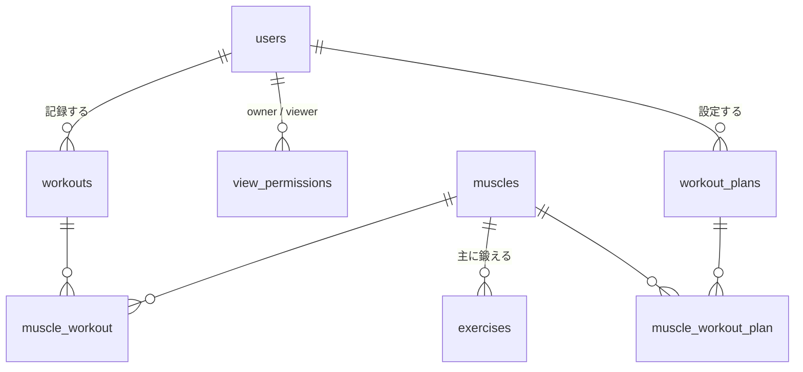

## 概要
 
筋トレ自己管理アプリのデータベース設計。
Laravel の Livewire スターターキットを使うため、`users` は既存のものをそのまま使う。まずは最小構成で作り、必要になったら足す。
 
## 方針
 
- 新規テーブルは **6つ**（記録まわり4つ＋通知プラン2つ）。`users` にはカラムを追加しない
- テンプレート・ブログは後回し（下の「後で追加するもの」参照）
- 重量・回数・セット数は `workouts` のカラムとして記録する（記録ごとに1つ。#12）
## テーブル
 
### 新規テーブル
 
**muscles**（筋肉のマスタ。Seeder で投入）
 
| カラム | 型 | 備考 |
|---|---|---|
| id | bigint PK | |
| name | string | 大胸筋、広背筋 など |
 
**exercises**（種目のマスタ。おすすめ提案とフォームの選択肢用。Seeder で投入）
 
| カラム | 型 | 備考 |
|---|---|---|
| id | bigint PK | |
| name | string | ベンチプレス など |
| muscle_id | foreignId | 主に鍛える筋肉 |
| default_rest_days | unsignedTinyInteger | 推奨休憩日数 |
 
**workouts**（筋トレ記録）
 
| カラム | 型 | 備考 |
|---|---|---|
| id | bigint PK | |
| user_id | foreignId | cascadeOnDelete |
| performed_at | dateTime | 実行日時 |
| menu_name | string | 自由入力のメニュー名 |
| weight | decimal(5,1) NULL | 重量(kg)。自重は NULL。0〜500、0.5 刻み |
| reps | unsignedSmallInteger NULL | 回数。1〜100。フォームでは必須（追加前の記録は NULL） |
| sets | unsignedTinyInteger NULL | セット数。1〜20。フォームでは必須（追加前の記録は NULL） |
| rest_days | unsignedTinyInteger | 休憩日数（選択式。0〜7） |
| timestamps | | |
 
**muscle_workout**（記録 ⇔ 使用した筋肉の中間テーブル）
 
| カラム | 型 | 備考 |
|---|---|---|
| muscle_id | foreignId | |
| workout_id | foreignId | cascadeOnDelete |
 
**view_permissions**（閲覧許可。行がある＝許可済み）
 
| カラム | 型 | 備考 |
|---|---|---|
| id | bigint PK | |
| owner_id | foreignId → users | 見せる側 |
| viewer_id | foreignId → users | 見る側 |
| | UNIQUE(owner_id, viewer_id) | |
 
**workout_plans**（通知プラン。設定した時間・場所・メニュー・筋肉でメールを送る）
 
| カラム | 型 | 備考 |
|---|---|---|
| id | bigint PK | |
| user_id | foreignId | cascadeOnDelete |
| scheduled_at | dateTime | 予定日時。この日時に1回だけ通知する |
| place | string | 場所（自由入力） |
| menu_name | string | メニュー名 |
| is_enabled | boolean | default true。false なら送信しない |
| sent_at | dateTime NULL | 送信日時。NULL なら未送信（二重送信防止） |
| timestamps | | |
 
**muscle_workout_plan**（通知プラン ⇔ 筋肉の中間テーブル）
 
| カラム | 型 | 備考 |
|---|---|---|
| muscle_id | foreignId | |
| workout_plan_id | foreignId | cascadeOnDelete |
 
## ER図
 

 
## 機能の実現方法
 
- **休ませる筋肉**: 直近14日の `workouts` を取得し、`performed_at + rest_days` が現在より後の筋肉を「休ませる筋肉」とする（PHP で計算）
- **おすすめ**: 休ませていない筋肉の `exercises` を表示する
- **継続日数**: `performed_at` の日付を、今日（または昨日）から連続している日数だけ数える
- **閲覧制御**: 本人、または `view_permissions` に行がある場合のみ記録を表示。それ以外はアカウント名だけ
- **リマインド**: スケジューラで毎分 `reminders:send` を実行し、`is_enabled` が true、`sent_at` が NULL、`scheduled_at` が現在以前の `workout_plans` についてメール送信。送信後に `sent_at` を記録する。メールには入力フォームへのリンク（プランID指定）を含める
- **プラン作成時の休息チェック**: `scheduled_at` の時点で休息中の筋肉が含まれていたら、作成・更新できない（休息判定クラスに基準日時を渡して判定）
## 後で追加するもの
 
必要になったときに足せば、今の設計を壊さずに済む。
 
- 初心者向けテンプレート → `workout_templates` を追加（まずは `exercises` から選ぶだけでも代用できる）
- ホームのブログ → `posts` を追加
- セットごとに重量・回数を変えた記録 → `workout_sets` を追加（今は記録ごとに1つの値）
- 閲覧の申請・承認 → `view_permissions` に `status` を追加
## タスク
 
- [ ] マイグレーション作成（muscles → exercises → workouts → muscle_workout → view_permissions → workout_plans → muscle_workout_plan）
- [ ] モデルとリレーションの作成
- [ ] muscles / exercises の Seeder 作成
- [ ] 閲覧制御の Policy 作成
- [ ] リマインド用コマンドとスケジューラの作成
- [x] タイムゾーンを `Asia/Tokyo` に統一する
## 今後決めるべきこと
- [x] 重量・回数・セット数を記録するか → 記録する（`workouts` に weight / reps / sets。#12）
 