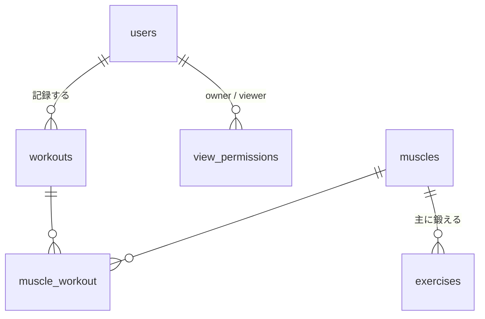

## 概要
 
筋トレ自己管理アプリのデータベース設計。
Laravel の Livewire スターターキットを使うため、`users` は既存のものをそのまま使う。まずは最小構成で作り、必要になったら足す。
 
## 方針
 
- 新規テーブルは **4つだけ**
- テンプレート・ブログ・セット数の記録は後回し（下の「後で追加するもの」参照）
## テーブル
 
### 既存の `users` に追加するカラム（リマインド用）
 
| カラム | 型 | 備考 |
|---|---|---|
| remind_time | time NULL | 通知時刻。NULL ならリマインドなし |
| last_reminded_at | dateTime NULL | 二重送信防止 |
 
### 新規テーブル
 
**muscles**（筋肉のマスタ。Seeder で投入）
 
| カラム | 型 | 備考 |
|---|---|---|
| id | bigint PK | |
| name | string | 大胸筋、広背筋 など |
 
**exercises**（種目のマスタ。おすすめ提案とフォームの選択肢用。Seeder で投入）
 
| カラム | 型 | 備考 |
|---|---|---|
| id | bigint PK | |
| name | string | ベンチプレス など |
| muscle_id | foreignId | 主に鍛える筋肉 |
| default_rest_days | unsignedTinyInteger | 推奨休憩日数 |
 
**workouts**（筋トレ記録）
 
| カラム | 型 | 備考 |
|---|---|---|
| id | bigint PK | |
| user_id | foreignId | cascadeOnDelete |
| performed_at | dateTime | 実行日時 |
| menu_name | string | 自由入力のメニュー名 |
| rest_days | unsignedTinyInteger | 休憩日数（選択式。0〜7） |
| timestamps | | |
 
**muscle_workout**（記録 ⇔ 使用した筋肉の中間テーブル）
 
| カラム | 型 | 備考 |
|---|---|---|
| muscle_id | foreignId | |
| workout_id | foreignId | cascadeOnDelete |
 
**view_permissions**（閲覧許可。行がある＝許可済み）
 
| カラム | 型 | 備考 |
|---|---|---|
| id | bigint PK | |
| owner_id | foreignId → users | 見せる側 |
| viewer_id | foreignId → users | 見る側 |
| | UNIQUE(owner_id, viewer_id) | |
 
## ER図
 

 
## 機能の実現方法
 
- **休ませる筋肉**: 直近14日の `workouts` を取得し、`performed_at + rest_days` が現在より後の筋肉を「休ませる筋肉」とする（PHP で計算）
- **おすすめ**: 休ませていない筋肉の `exercises` を表示する
- **継続日数**: `performed_at` の日付を、今日（または昨日）から連続している日数だけ数える
- **閲覧制御**: 本人、または `view_permissions` に行がある場合のみ記録を表示。それ以外はアカウント名だけ
- **リマインド**: スケジューラで毎分コマンドを実行し、`remind_time` に該当するユーザーへメール送信
## 後で追加するもの
 
必要になったときに足せば、今の設計を壊さずに済む。
 
- 初心者向けテンプレート → `workout_templates` を追加（まずは `exercises` から選ぶだけでも代用できる）
- ホームのブログ → `posts` を追加
- 重量・回数・セット数 → `workout_sets` を追加
- 閲覧の申請・承認 → `view_permissions` に `status` を追加
## タスク
 
- [ ] マイグレーション作成（muscles → exercises → workouts → muscle_workout → view_permissions、`users` へのカラム追加）
- [ ] モデルとリレーションの作成
- [ ] muscles / exercises の Seeder 作成
- [ ] 閲覧制御の Policy 作成
- [ ] リマインド用コマンドとスケジューラの作成
- [ ] タイムゾーンを `Asia/Tokyo` に統一するか
## 今後決めるべきこと
- [ ] 重量・回数・セット数を記録するか
 